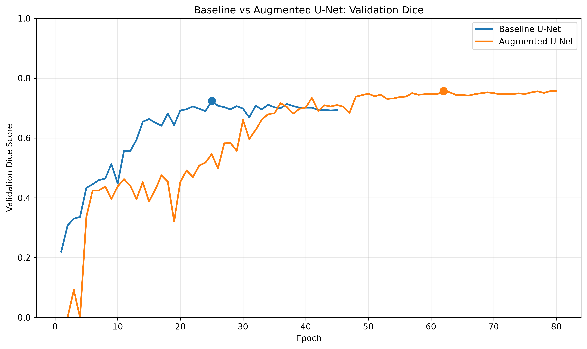
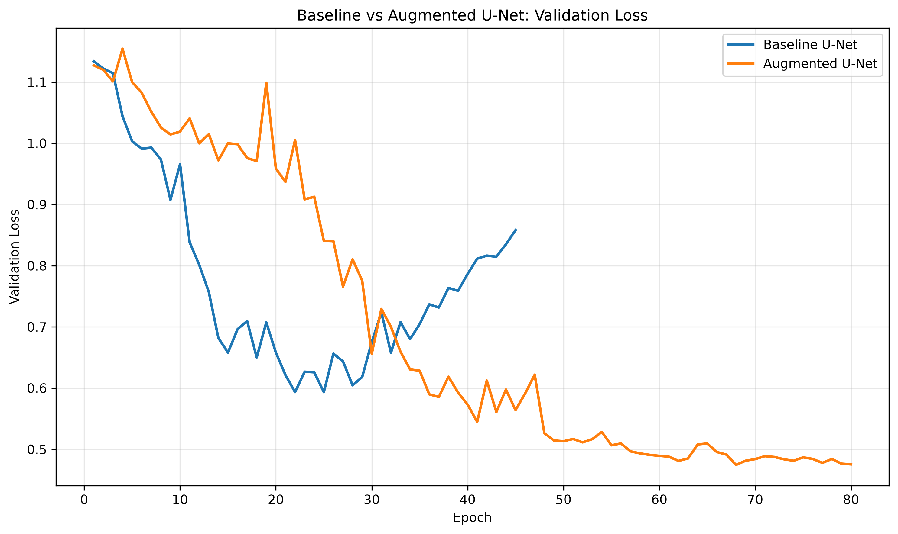
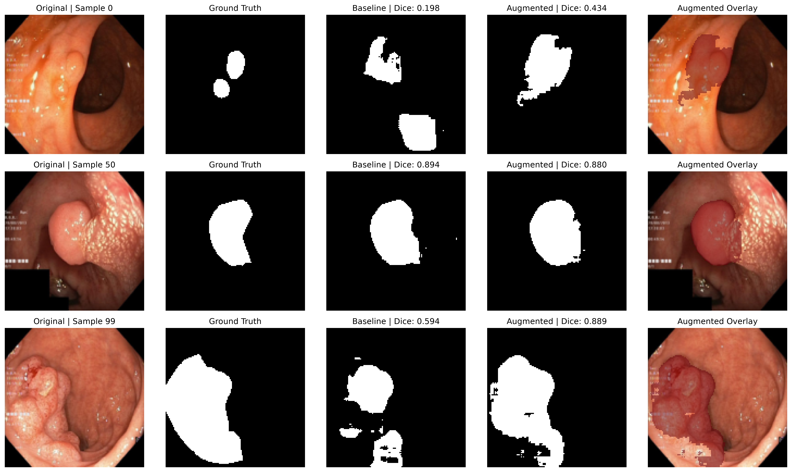

# Polyp Segmentation with U-Net: Evaluating Data Augmentation on Kvasir-SEG

A PyTorch-based medical image segmentation project investigating the impact of data augmentation on U-Net performance for colorectal polyp segmentation.

The project includes a lightweight U-Net implementation, reproducible training experiments, validation-based model selection, held-out test evaluation, and qualitative error analysis.

## Project Overview

Accurate polyp segmentation in colonoscopy images is challenging because of variations in polyp size, appearance, illumination, and surrounding tissue.

This project investigates whether geometric and photometric data augmentation can improve the segmentation performance of a lightweight U-Net trained from scratch.

**Key findings:**
- Augmented U-Net achieved a test Dice score of **0.7682**, compared with **0.7194** for the baseline.
- Data augmentation improved mean test Dice by **4.87 percentage points**.
- The augmented model performed better on 64 of 100 test images.
- Small polyp regions and difficult visual cases remained challenging.

## Dataset

Experiments use the **Kvasir-SEG** dataset, containing 1,000 colonoscopy images with corresponding pixel-level polyp segmentation masks.

- Dataset: [Kvasir-SEG](https://datasets.simula.no/kvasir-seg/)
- Reference: [Jha et al., Kvasir-SEG: A Segmented Polyp Dataset (2020)](https://doi.org/10.1007/978-3-030-37734-2_37)

The dataset was divided into image-level training, validation, and test subsets using random seed 42.

| Split | Images |
|---|---:|
| Training | 800 |
| Validation | 100 |
| Test | 100 |

Images were resized to 128 × 128 pixels and normalized to [0, 1]. Segmentation masks were resized using nearest-neighbor interpolation and binarized.

The original dataset is not redistributed in this repository. Its research and educational use restrictions apply.

## Model Architecture

The model is a compact U-Net implemented from scratch in PyTorch.

- Encoder-decoder architecture with skip connections
- Three encoder stages and a bottleneck
- Transposed convolutions for upsampling
- Single-channel segmentation logits
- **482,033 trainable parameters**
- No pretrained weights

The architecture was designed to support training on limited computational resources.

## Experimental Setup

Two primary configurations were compared:

**Baseline U-Net**
- Standard image preprocessing
- No training-time augmentation
- Adam optimizer
- Combined binary cross-entropy and Dice loss
- Learning-rate scheduling and early stopping

**Augmented U-Net**
- Same model architecture and core optimization setup
- Random horizontal and vertical flips
- Random 90-degree rotations
- Random brightness and contrast adjustments

Both primary experiments used a batch size of 4, an initial learning rate of 0.001, and a maximum of 80 epochs with early stopping.

Model checkpoints were selected using validation performance. Prediction thresholds were also selected exclusively on the validation set before final test evaluation.

## Quantitative Results

Evaluation was performed on the held-out test set containing 100 images. Segmentation metrics were averaged across images.

| Metric | Baseline U-Net | Augmented U-Net |
|---|---:|---:|
| Validation Dice | 0.7240 | **0.7592** |
| Test Dice | 0.7194 | **0.7682** |
| Test IoU | 0.6046 | **0.6656** |
| Test Precision | 0.7726 | **0.7853** |
| Test Recall | 0.7489 | **0.8222** |
| Test Loss | 0.5993 | **0.4824** |
| Selected Threshold | 0.55 | 0.30 |

The augmented model achieved a **0.0487 absolute improvement in mean test Dice** over the baseline.

These results describe the current experimental split and training runs; they do not establish statistical significance or clinical readiness.

## Training Curves

Training and validation curves were recorded to examine
model convergence and generalization behavior.

### Validation Dice



### Validation Loss



## Qualitative Evaluation

Predictions from both models were compared against ground-truth segmentation masks.

The visualization includes:
- Original colonoscopy images
- Ground-truth masks
- Baseline predictions
- Augmented-model predictions
- Segmentation overlays

Representative examples include cases where augmentation improves segmentation, cases where the baseline performs slightly better, and cases where both approaches encounter difficulties.

### Prediction Examples

The figure below compares the original colonoscopy images,
ground-truth masks, baseline predictions, and augmented
U-Net predictions on three fixed test samples.



The augmented model improves segmentation in some examples,
while the baseline performs slightly better in others.
Both models still exhibit errors on challenging images.

## Error Analysis

Per-image comparisons were conducted on the held-out test set.

| Outcome | Number of Images |
|---|---:|
| Augmented model performed better | 64 |
| Baseline model performed better | 35 |
| Approximately equal performance | 1 |

Performance was also examined according to the ground-truth mask area relative to the image.

| Relative Mask Area | Images | Baseline Dice | Augmented Dice |
|---|---:|---:|---:|
| Small (≤5%) | 19 | 0.5558 | **0.6024** |
| Medium (5–20%) | 47 | 0.7926 | **0.8235** |
| Large (>20%) | 34 | 0.7098 | **0.7844** |

The size categories are based on relative pixel area, not clinically measured polyp dimensions.

Although augmentation improved average segmentation performance in all three groups, several samples produced very low Dice scores, highlighting the need for further robustness evaluation.

## Project Structure

- `src/` — Dataset loading, U-Net architecture, losses, metrics, training and evaluation
- `experiments/` — Baseline and augmentation training configurations
- `tests/` — Implementation checks
- `notebooks/` — Data exploration, result visualization and analysis
- `data/splits.csv` — Fixed image-level dataset split
- `outputs/metrics/` — Training histories and evaluation results
- `outputs/plots/` — Training curves and qualitative comparisons
- `config.py` — Shared configuration
- `requirements.txt` — Project dependencies
- `requirements-lock.txt` — Recorded environment dependencies

## Installation

### Environment

The original experiments were conducted on Windows using:

- Python 3.13
- PyTorch 2.14.1+cpu
- CPU-based training and evaluation

The complete Python package versions used in the original
environment are recorded in `requirements-lock.txt`.

### Setup (Windows PowerShell)

Clone the repository and navigate to the project directory:

```powershell
git clone https://github.com/elinaebadi/polyp-segmentation-unet.git
cd Polyp-Segmentation
```

Create and activate a virtual environment:

```powershell
python -m venv .venv
.\.venv\Scripts\Activate.ps1
```

Upgrade pip:

```powershell
python -m pip install --upgrade pip
```

For CPU-only PyTorch, install the CPU build first:

```powershell
python -m pip install torch --index-url https://download.pytorch.org/whl/cpu
```

Install the project dependencies:

```powershell
python -m pip install -r requirements.txt
```

Verify the installation:

```powershell
python -m pip check
python -c "import torch; print(torch.__version__)"
```

For other operating systems or GPU installations, consult
the [official PyTorch installation guide](https://pytorch.org/get-started/locally/).

**Note:** `requirements-lock.txt` documents the original
Windows environment. It is not guaranteed to install
unchanged on every platform. Installing from
`requirements.txt` may resolve newer compatible package
versions, so exact experimental reproduction is not guaranteed.

## Dataset Preparation

Download Kvasir-SEG from the official website and organize the files as follows:

```text
data/
├── splits.csv
└── raw/
    └── Kvasir-SEG/
        ├── images/
        └── masks/
```

The fixed `splits.csv` file defines the train, validation and test assignments used in the reported experiments.

## Testing

Basic implementation checks can be executed from the
project root directory.

### Model Architecture

```bash
python -m tests.test_model
```

Verifies the U-Net output dimensions and reports the
number of trainable parameters.

### Loss Functions

```bash
python -m tests.test_losses
```

Checks the Dice loss and combined BCE-Dice loss.

### Evaluation Metrics

```bash
python -m tests.test_metrics
```

Checks Dice, IoU, precision, and recall calculations.

### Training Integration Checks

The following tests use actual Kvasir-SEG images and masks,
so the dataset must be downloaded and placed in the expected
directory before running them:

```bash
python -m tests.test_training_step
python -m tests.test_training_loop
```

These tests execute a limited number of training operations
on newly initialized models. They do not retrain the full
experiments or overwrite the original checkpoints.

Passing these checks does not guarantee complete correctness
or identical results across environments.

## Running Experiments

All commands should be executed from the project root directory.

### Training

Three training experiments are available:

```bash
# Initial baseline
python -m experiments.run_baseline

# Baseline with learning-rate scheduling
python -m experiments.run_baseline_v2

# U-Net with data augmentation
python -m experiments.run_augmented
```

Each new training run creates a unique directory under:

```text
outputs/runs/<experiment_name>/<run_id>/
├── best.pth
└── history.csv
```

This prevents new training runs from overwriting the
original experiment artifacts.

The `outputs/runs/` directory is excluded from Git.

### Validation Evaluation

To evaluate a newly trained checkpoint on the validation
set, run:

```bash
python -m src.evaluate --split val --checkpoint PATH_TO_CHECKPOINT --threshold 0.5
```

Replace `PATH_TO_CHECKPOINT` with the actual path to the
saved `best.pth` file.

The evaluation script saves results in a unique directory:

```text
outputs/runs/evaluations/<run_id>/val_results.csv
```

### Final Test Evaluation

The test set should be evaluated only after model selection
and threshold selection have been finalized using validation
data.

The evaluation script accepts a JSON file containing
validation-selected checkpoints and thresholds:

```bash
python -m src.evaluate --split test --selection PATH_TO_SELECTION_JSON
```

The selection JSON must reference checkpoint files that
exist on the local machine.

The repository includes:

- `outputs/metrics/model_selection.json`
- `outputs/metrics/test_results.csv`
- `outputs/metrics/test_error_analysis.csv`

These files document the original experiments.

**Important:** The original trained checkpoints are excluded
from Git. Therefore, the provided model selection JSON cannot
be used for inference on a fresh clone unless the original
checkpoints are supplied separately.

Newly trained checkpoints can be evaluated by creating a
separate selection JSON using validation results.

Test results must not be used to select models, optimize
thresholds, or tune hyperparameters.

### Reproducibility Notes

- Random seed: 42
- Image-level split: 800 training / 100 validation / 100 test
- Input resolution: 128 × 128
- Batch size: 4
- Framework: PyTorch
- Training device used: CPU

The original training histories and reported metrics are
preserved for reference. Exact numerical reproduction across
different systems and library versions is not guaranteed.

## Limitations

- Results are based on one fixed image-level split and one training run per main configuration.
- Patient-level independence could not be verified from the available metadata.
- Training at 128 × 128 resolution may limit preservation of fine segmentation details.
- Some test images produced near-zero Dice scores despite improvements in average performance.
- The model has not been validated on an independent external dataset.
- Statistical significance across repeated training runs has not been established.
- This implementation is for research and educational purposes, not clinical decision-making.

## Future Work

Potential extensions include higher-resolution training, repeated experiments with multiple random seeds, external dataset evaluation, and systematic analysis of segmentation failures.

## Dataset Citation

Jha, D., Smedsrud, P. H., Riegler, M. A., Halvorsen, P., de Lange, T., Johansen, D., & Johansen, H. D. (2020). *Kvasir-SEG: A Segmented Polyp Dataset*. International Conference on Multimedia Modeling, 451–462.

https://doi.org/10.1007/978-3-030-37734-2_37
